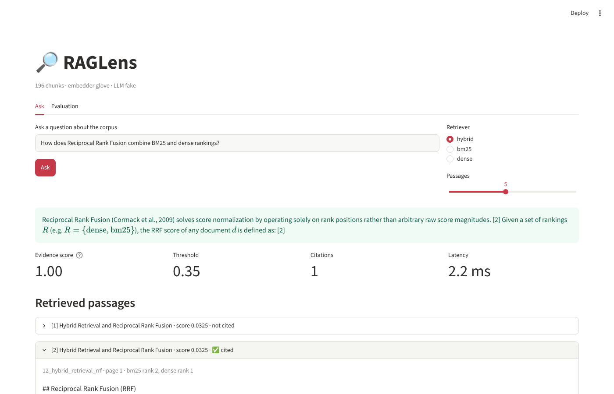
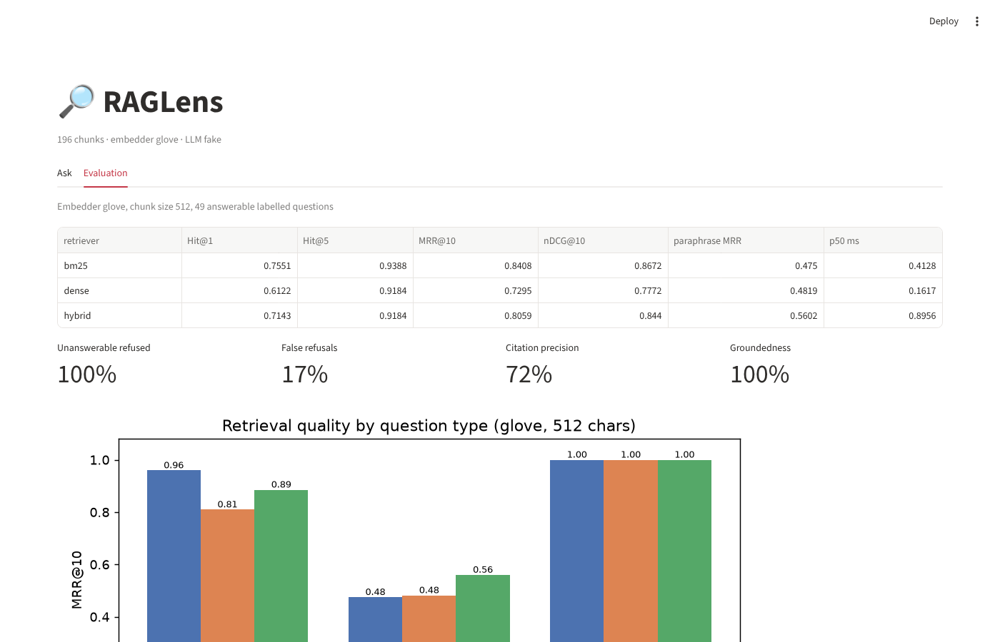
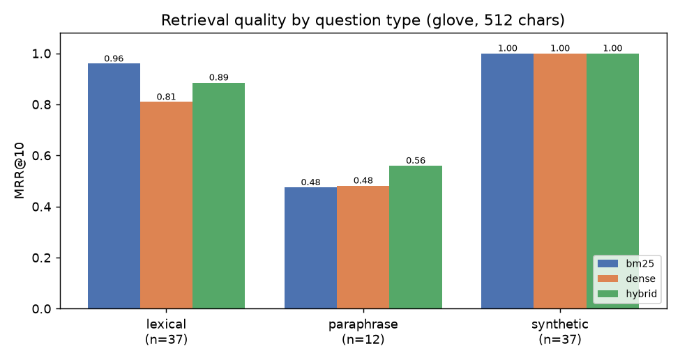

# RAGLens

**Retrieval-Augmented Generation you can measure.** Hybrid BM25 + dense retrieval fused with
Reciprocal Rank Fusion, answers with verified `[n]` citations, a refusal gate tuned on held-out
data, and an evaluation harness with significance tests, ablations and honest failure analysis.


| Ask (hybrid, with evidence trail) | Evaluation dashboard |
|---|---|
|  |  |

> New to the project? Read **[docs/HOW_IT_WORKS.md](docs/HOW_IT_WORKS.md)**: every component
> and every evaluation number explained in plain language, with interview Q&A.

## Results at a glance

All numbers come from `raglens eval` ([full report](docs/proof/eval_report.md),
[raw JSON](docs/proof/eval_results.json)). Embedder `glove`, 512-character chunks,
59 hand-labelled questions (37 keyword, 12 paraphrase, 10 unanswerable).

| Retriever | Hit@1 | Hit@5 | MRR@10 | nDCG@10 | Paraphrase MRR |
|---|---|---|---|---|---|
| BM25 | 0.755 | 0.939 | **0.841** | **0.867** | 0.475 |
| Dense (FAISS) | 0.612 | 0.918 | 0.729 | 0.777 | 0.482 |
| Hybrid (RRF) | 0.714 | 0.918 | 0.806 | 0.844 | **0.560** |

- **Hybrid vs dense:** +0.076 MRR, 95% CI [+0.009, +0.145]: significant.
- **Hybrid vs BM25:** −0.035, 95% CI [−0.112, +0.038]: a statistical tie. Hybrid wins on
  paraphrases; BM25 wins on keyword questions. [Why, with traces](docs/HOW_IT_WORKS.md#why-hybrid-does-not-simply-beat-bm25-two-real-traces).
- **Refusals (test split):** 100% of unanswerable questions refused, 16.7% of answerable
  questions wrongly refused, threshold 0.35 chosen on the dev split only.
- **Answers:** citation precision 0.725, groundedness 1.00 (extractive offline generator),
  end-to-end p50 1.0 ms.
- **Ablation:** fusing a meaningless retriever (`hash`) cuts nDCG@10 from 0.867 (BM25) to 0.680.
  Hybrid is only as good as its weaker member.
- **Negative result:** tuning a BM25/dense weight inside RRF on dev did not transfer to test,
  so plain RRF is kept ([experiment](docs/proof/rrf_weight_experiment.txt)).



## Architecture

```
            ┌──────────────┐   chunks    ┌──────────────┐
 .md .txt ─►│ ingest/parse │────────────►│ BM25 index   │──┐
 .pdf       │ + recursive  │             └──────────────┘  │  Reciprocal     top-k      evidence      ┌─► FakeLLM / Ollama /
            │   chunking   │────────────►┌──────────────┐  ├─ Rank Fusion ─► passages ─► gate ───────┤   OpenAI-compatible ─► answer + [n]
            └──────────────┘  embeddings │ FAISS (cos)  │──┘  (k = 60)        (+rerank)  (coverage    │                       citations checked
                                         └──────────────┘                                ≥ 0.35)     └─► "I don't know based on the provided documents."
```

| Layer | Implementation |
|---|---|
| Ingestion | `.md`, `.txt`, `.pdf` (pypdf) with page numbers and character offsets |
| Chunking | Recursive character splitter (paragraph → line → sentence → word) and a sentence-aware variant |
| Lexical | BM25 Okapi (`rank_bm25`, k1 = 1.5, b = 0.75) |
| Dense | FAISS `IndexFlatIP` over unit vectors (exact cosine) |
| Embedders | `minilm` (sentence-transformers, default) → `glove` (pretrained word vectors + SIF) → `lsa` (TF-IDF + SVD) fallback chain; `hash` control |
| Fusion | Reciprocal Rank Fusion, per-retriever ranks kept for explanations |
| Reranking | Optional cross-encoder `ms-marco-MiniLM-L-6-v2`, lazily loaded |
| Generation | `FakeLLM` (extractive, deterministic), `OllamaLLM`, `OpenAICompatLLM`; timeouts, exponential-backoff retries, typed errors |
| Persistence | FAISS index + chunks + fitted embedder state (JSON / NPZ, no pickle); loading does not re-embed |
| Interfaces | Typer CLI, FastAPI (`/health`, `/ask`, `/ingest`, `/eval`, OpenAPI at `/docs`), Streamlit UI |

## Quickstart

### Local (Linux / macOS)

```bash
python3.11 -m venv .venv && source .venv/bin/activate
pip install -e ".[dev]"            # core + tests (offline LSA embeddings)
pip install -e ".[vectors]"        # optional: pretrained GloVe vectors (~400 MB, from GitHub)
pip install -e ".[minilm]"         # optional: MiniLM + cross-encoder (from Hugging Face)

raglens ingest                     # index data/sample_corpus -> data/index
raglens ask "How does Reciprocal Rank Fusion combine BM25 and dense rankings?"
raglens eval                       # full evaluation -> docs/proof/eval_report.md
raglens serve                      # API on http://localhost:8000/docs
streamlit run src/raglens/ui/app.py
```

### Windows PowerShell

```powershell
.\scripts\raglens.ps1 install
.\scripts\raglens.ps1 test
.\scripts\raglens.ps1 eval
.\scripts\raglens.ps1 serve
```

### Docker

```bash
docker compose up --build                  # API :8000, UI :8501 (LSA embeddings)
EXTRAS=vectors docker compose up --build   # with pretrained word vectors
```

Configuration is in `.env` (copy `.env.example`): embedder, chunk size, LLM provider
(`fake` | `ollama` | `openai`), refusal threshold, upload limit.

## API

| Method | Path | Body | Returns |
|---|---|---|---|
| GET | `/health` | | status, chunk count, embedder, LLM, threshold |
| POST | `/ask` | `{"question": str, "retriever": "hybrid"\|"bm25"\|"dense", "top_k": 1-20, "rerank": bool}` | answer, citations, retrieved passages with per-retriever ranks, evidence score, timings |
| POST | `/ingest` | multipart `files` (.md/.txt/.pdf, ≤ 5 MB each) | files added, chunk counts |
| POST | `/eval` | `{"retriever": ..., "split": "dev"\|"test"\|"all"}` | retrieval and answer metrics on the bundled set |

```bash
curl -s -X POST localhost:8000/ask -H 'content-type: application/json' \
  -d '{"question": "How does SMOTE create new samples?", "retriever": "hybrid", "top_k": 3}'
```

Sample test values: *"What is the Gini impurity formula used in decision trees?"* (answered,
cites `04_decision_trees_and_ensembles`), *"What is the capital of Australia?"* (refused).
Unknown fields return 422, unsupported uploads 400, oversized uploads 413, LLM outages 503.
Real transcripts: [`docs/proof/api_demo.txt`](docs/proof/api_demo.txt),
[`docs/proof/cli_demo.txt`](docs/proof/cli_demo.txt).

## Evaluation protocol (short version)

1. Retrieval metrics (Hit@k, Recall@k, MRR, nDCG for k = 1, 3, 5, 10) on all answerable
   hand-labelled questions, scored at **document** level; synthetic questions reported separately.
2. The refusal threshold is tuned on the **dev** split (balanced accuracy); answer metrics are
   reported on **test** only.
3. Paired bootstrap (2,000 resamples) 95% confidence intervals for retriever comparisons.
4. Ablation: retriever × chunk size {256, 512, 1024} × embedder {glove, lsa, hash}.
5. The report lists every question where retrievers disagree and every hybrid miss.

## Limitations

- **MiniLM and the cross-encoder were not evaluated**: the build sandbox could not reach
  Hugging Face, so the `hybrid+rerank` row is skipped, not faked. Run
  `raglens eval --embedders minilm,glove,lsa --main-embedder minilm` with internet access.
- **Docker files were written but not built here** (no Docker daemon in the sandbox). The wheel
  was built and installed into a clean environment and answered questions from it.
- 59 questions is small: confidence intervals are wide.
- The offline generator is extractive, so groundedness is 1.0 by construction; plug in Ollama
  or an OpenAI-compatible model for a real hallucination test.
- The word-coverage gate can pass a wrong answer that shares generic words with the question
  (documented example in [HOW_IT_WORKS](docs/HOW_IT_WORKS.md#known-failure-you-should-mention-before-an-interviewer-finds-it)).

## Proof

| File | Produced by |
|---|---|
| [`docs/proof/eval_report.md`](docs/proof/eval_report.md), `eval_results.json`, charts | `raglens eval` |
| [`docs/proof/rrf_weight_experiment.txt`](docs/proof/rrf_weight_experiment.txt) | `python scripts/rrf_weight_experiment.py` |
| [`docs/proof/cli_demo.txt`](docs/proof/cli_demo.txt), [`api_demo.txt`](docs/proof/api_demo.txt) | `./scripts/run_demos.sh` |
| [`docs/proof/pytest.txt`](docs/proof/pytest.txt), [`lint.txt`](docs/proof/lint.txt) | `pytest --cov`, `ruff`, `mypy` |
| [`docs/proof/retrieval_bench.txt`](docs/proof/retrieval_bench.txt) | `python scripts/benchmark_retrieval.py` |
| [`docs/screenshots/`](docs/screenshots) | `python scripts/capture_screenshots.py` (headless Chrome) |

## Project layout

```
src/raglens/
  ingest/  chunking/  embed/  retrieve/  rerank/  llm/  pipeline/  eval/  api/  cli/  ui/
data/sample_corpus/   20 original ML documents
data/eval/            qa.jsonl + build_qa.py (labelled questions with dev/test split)
docs/                 HOW_IT_WORKS.md, proof/, screenshots/
scripts/              demos, screenshots, benchmarks, RRF weight experiment, PowerShell runner
```

MIT licensed.
