<p align="center">
  
</p>

<p align="center">
  <a href="https://github.com/ronith21/raglens/actions/workflows/ci.yml"></a>
  
  
  
  
  <a href="docs/SECURITY_AUDIT.md"></a>
  
</p>

<p align="center">
  <b>Ask a question about banking regulation. Get an answer where every sentence points to its source,<br>
  or an honest "I don't know" when the documents don't cover it.</b>
</p>

<p align="center">
  <a href="#-see-it-in-action">Demo</a> ·
  <a href="#-results">Results</a> ·
  <a href="#-quickstart">Quickstart</a> ·
  <a href="#api">API</a> ·
  <a href="#-security">Security</a> ·
  <a href="docs/HOW_IT_WORKS.md">How it works</a>
</p>

---

## 💡 Why RAGLens?

Most RAG demos stop at "it answered". In banking, that's the dangerous part: a fluent answer
with no source, or a confident answer to a question the documents never covered.

RAGLens is built around three questions a compliance reviewer would ask:

| The question | RAGLens's answer |
|---|---|
| **"Where does this claim come from?"** | Every `[n]` citation links to the *exact sentence* in the source, highlighted, with a support score. |
| **"Should it have answered at all?"** | A learned refusal gate checks the evidence *before* the LLM is called and says "I don't know" when it is too weak. |
| **"How do you know it works?"** | A benchmark with held-out, paraphrased and deliberately unanswerable questions, and every mistake listed by question ID. |

## 🎬 See it in action

<p align="center">
  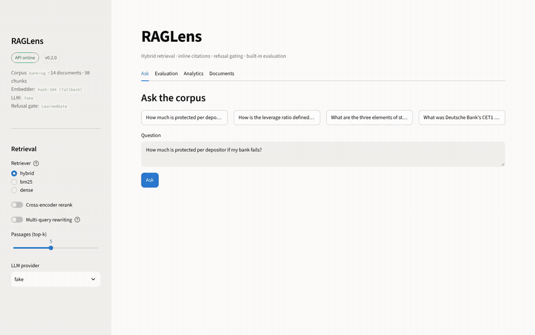<br>
  <sub>30-second walkthrough recorded from the running app on the banking corpus ·
  <a href="docs/proof/raglens_demo.mp4">download the MP4</a></sub>
</p>

### 1 · A cited answer, with the evidence highlighted


*"How much is protected per depositor if my bank fails?"*. Hybrid search finds the deposit
guarantee document; each citation shows the supporting sentence (100% support), and the
retrieved passage highlights it in place, with BM25, dense and fused ranks.

### 2 · An honest refusal instead of a hallucination

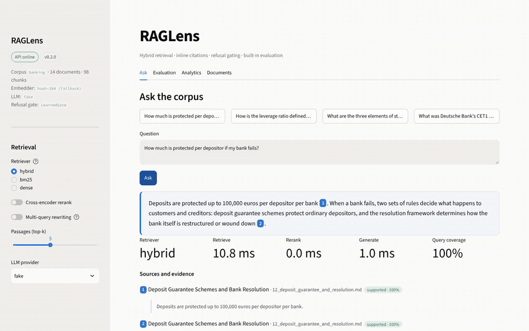

*"What was Deutsche Bank's CET1 ratio in 2024?"*. The corpus explains CET1 but contains no
bank's figures. The search still returns a Basel III passage, but the gate notices the question names
something the evidence never mentions and refuses at 15% confidence, **without calling the LLM**.

### 3 · Multi-query rewriting for acronyms

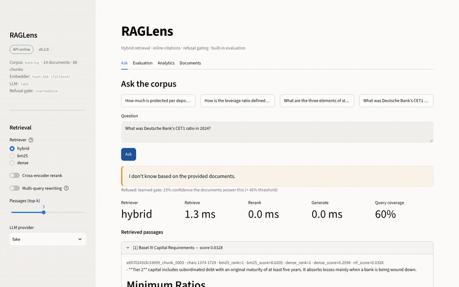

*"What does SCA require for online payments?"*. RAGLens learned from the documents that
SCA means *strong customer authentication*, searches all three phrasings and fuses the results.

### 4 · The evaluation dashboard

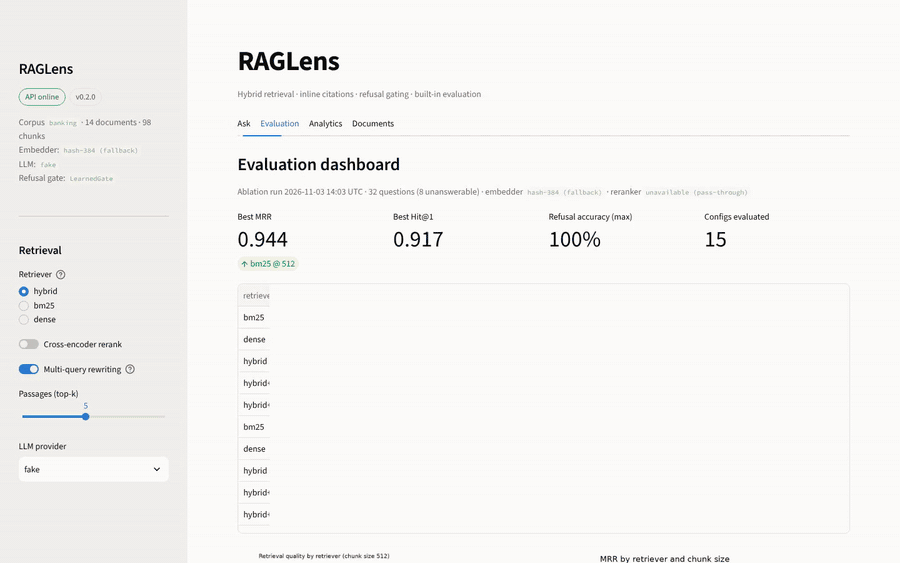

The full ablation (5 retrievers × 3 chunk sizes) on held-out questions, charts, and a live
re-evaluation of whatever settings are selected in the sidebar.

### 5 · Usage analytics and documents

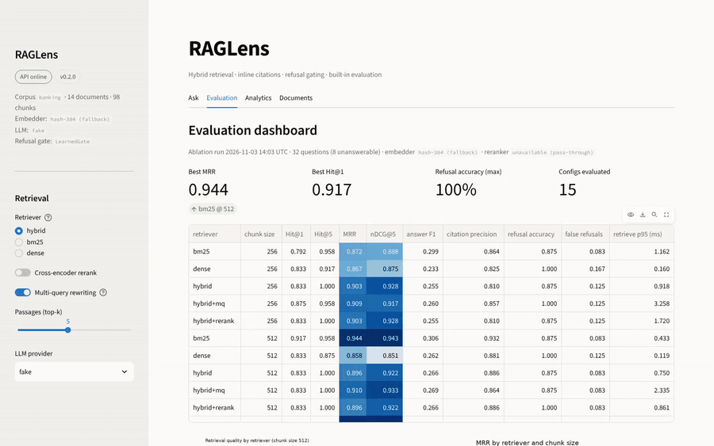

Questions are logged to SQLite with personal data masked, then summarised: refusal rate,
latency percentiles, most-used sources. The documents tab lists the index and accepts uploads.

<details>
<summary><b>📸 All screenshots</b> (click to expand)</summary>

| | |
|---|---|
| **Cited answer** 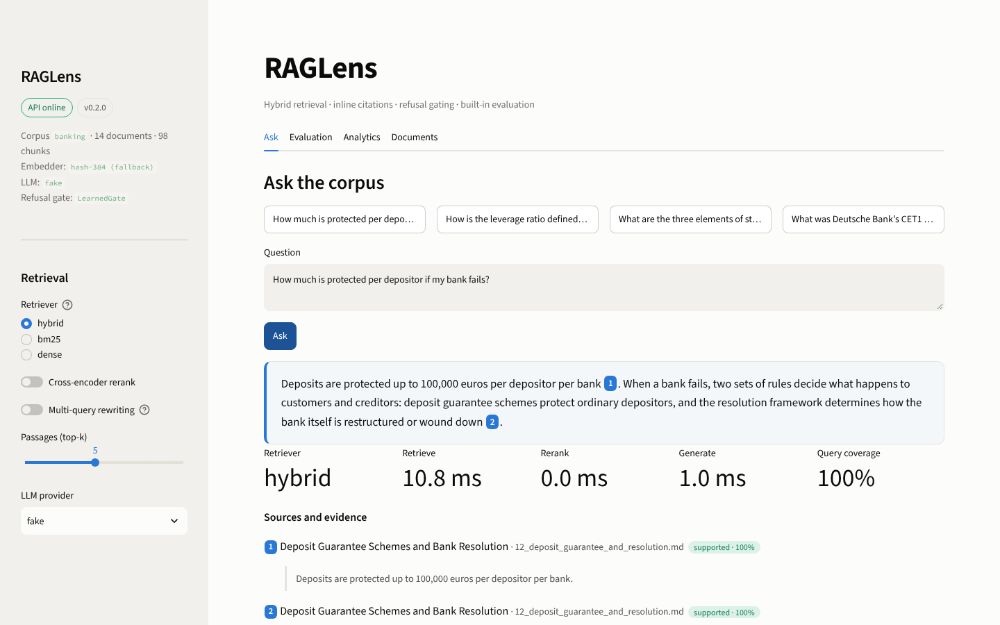 | **Evidence in the passage** 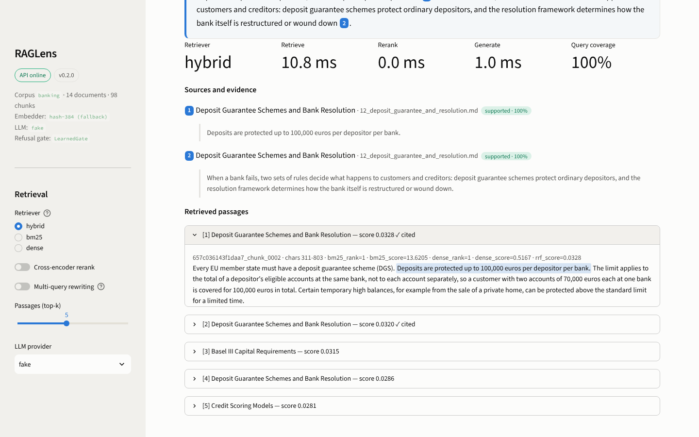 |
| **Refusal by the learned gate** 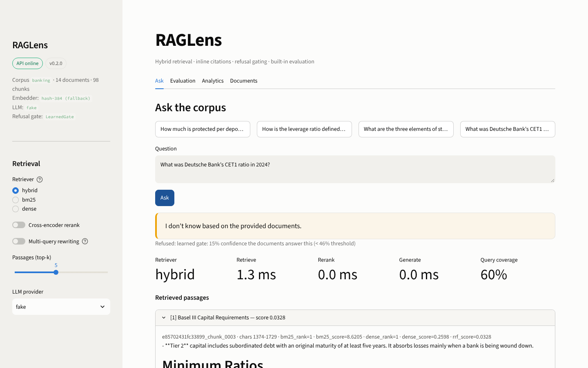 | **Multi-query rewriting** 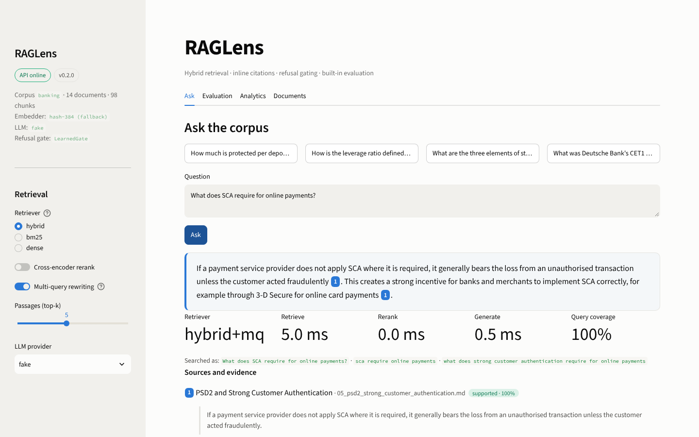 |
| **Benchmark dashboard** 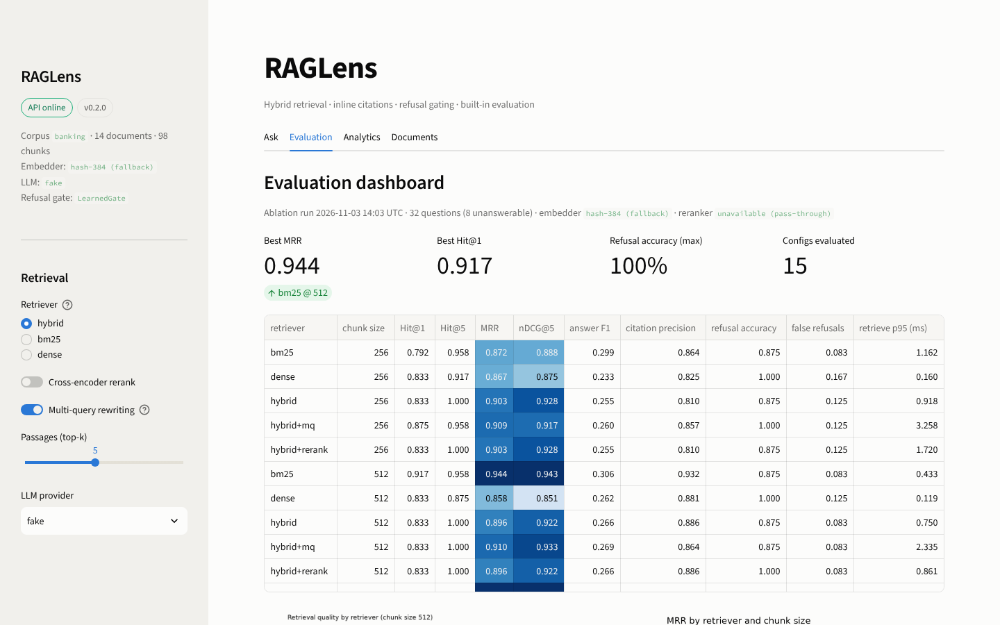 | **Benchmark charts** 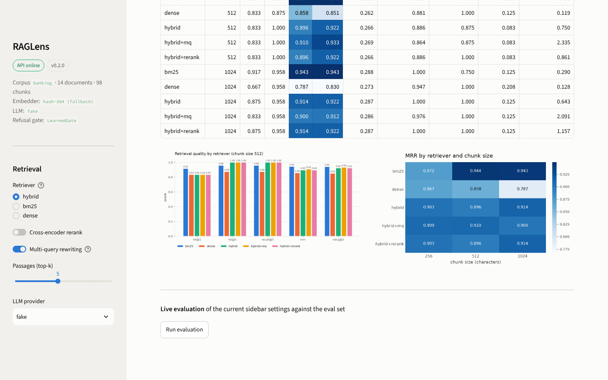 |
| **Live evaluation** 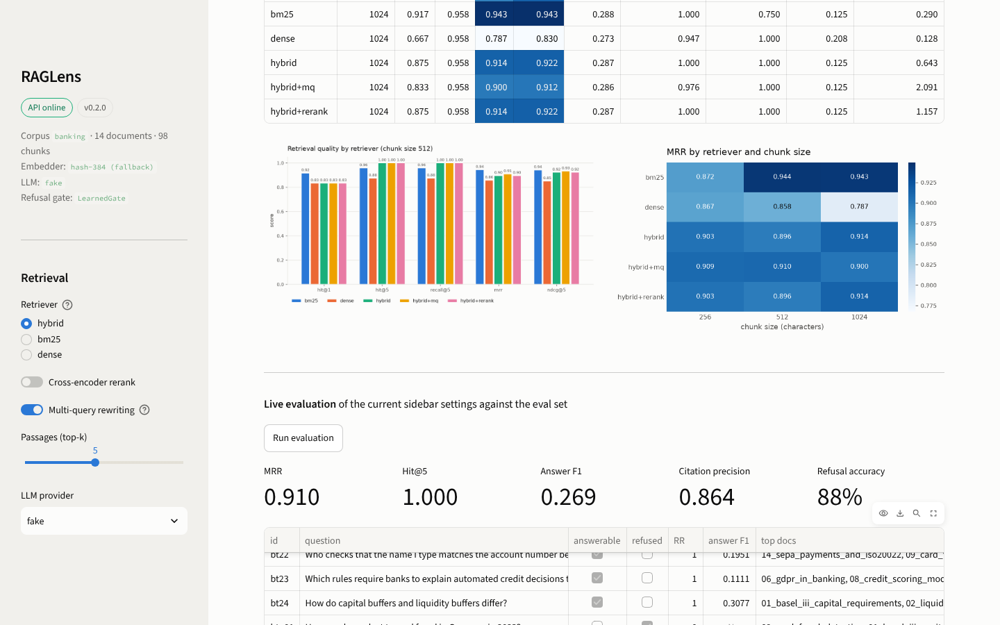 | **Usage analytics** 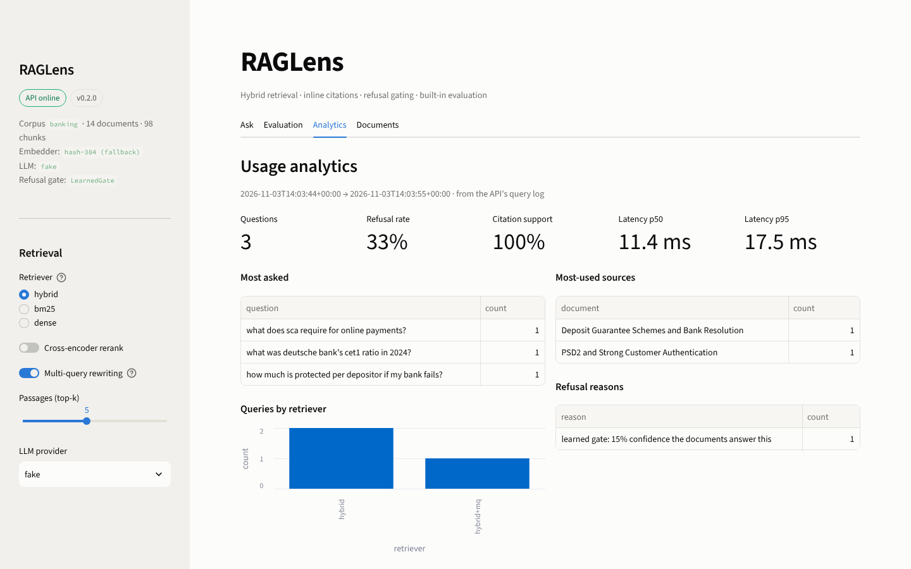 |
| **Documents and upload** 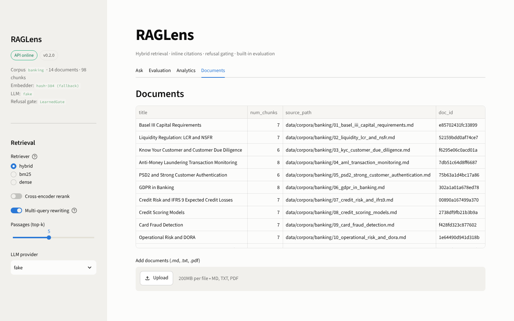 | **Interactive API docs** 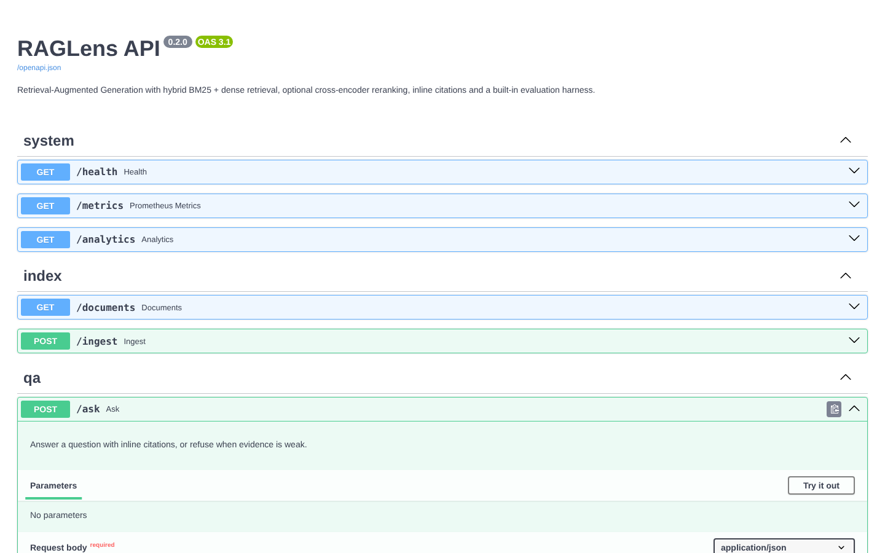 |

All captured automatically from the running app by
[`scripts/capture_screenshots.py`](scripts/capture_screenshots.py) (Playwright + Chrome DevTools
screencast + ffmpeg). Run `make screenshots` to regenerate them.
</details>

## ✨ Highlights

| | |
|---|---|
| 🧠 **Learned refusal gate** | Logistic regression over four interpretable signals, with the threshold set by cost (a wrong answer costs 3× a wrong refusal). On held-out questions it refuses **87.5%** of unanswerable questions vs 50% for a hand-tuned rule, and halves wrong refusals. |
| 🔎 **Hybrid retrieval** | BM25 + FAISS dense search fused with Reciprocal Rank Fusion; optional acronym-aware multi-query rewriting and cross-encoder reranking. |
| 📌 **Evidence, not just citations** | Each `[n]` resolves to the supporting sentence with a support score; weak or missing citations raise warnings. |
| 📊 **Honest evaluation** | Dev / held-out split; direct, paraphrased, multi-document and unanswerable questions; Hit@k, MRR, nDCG, citation precision, refusal accuracy, latency. |
| 🤖 **Real-LLM ready** | Ollama or any OpenAI-compatible API; normalises citation styles real models write (`[1, 2]`, `[1-3]`, `[Source 2]`) and recognises reworded refusals. |
| 🔒 **Security and privacy** | Audited against 19 web-security categories with live attacks ([report](docs/SECURITY_AUDIT.md)): CSRF origin checks, rate limits, upload sanitising, safe defaults without an API key, security headers. PII is masked before logging. |
| 📡 **Operations** | SQLite analytics, Prometheus `/metrics`, request IDs, dependency scanning in CI. |
| 🛠️ **Engineering** | 238 tests at 98% coverage, strict mypy, CI on Python 3.11/3.12, Docker, Hugging Face Spaces deploy, Windows PowerShell task runner. |

New to RAG? [docs/HOW_IT_WORKS.md](docs/HOW_IT_WORKS.md) explains every part in plain words.

## 🏗️ Architecture

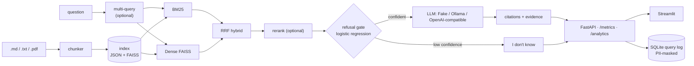

Details: [docs/architecture.md](docs/architecture.md) · spec: [SPEC.md](SPEC.md)

## 📈 Results

### Banking corpus, held-out questions

From `make eval-banking`: 14 documents, 32 held-out questions (16 direct, 6 paraphrased,
2 multi-document, 8 unanswerable), chunk size 512, learned refusal gate.

| Retriever | Hit@1 | Hit@3 | MRR | Paraphrase MRR | Citation precision | Refusal accuracy | False refusals | Retrieve p50 |
|---|---|---|---|---|---|---|---|---|
| **BM25** | **0.917** | 0.958 | **0.944** | **0.778** | **0.932** | 0.875 | **0.083** | 0.26 ms |
| Dense (hash fallback) | 0.833 | 0.833 | 0.858 | 0.431 | 0.881 | **1.000** | 0.125 | 0.08 ms |
| Hybrid (RRF) | 0.833 | **1.000** | 0.896 | 0.583 | 0.886 | 0.875 | **0.083** | 0.51 ms |
| Hybrid + multi-query | 0.833 | **1.000** | 0.910 | 0.639 | 0.864 | 0.875 | **0.083** | 1.61 ms |

Full ablation over 5 retrievers × 3 chunk sizes, per-type breakdown and every mistake by question
id: [docs/proof/banking/eval_report.md](docs/proof/banking/eval_report.md).

### The refusal gate

From `make gate` ([docs/proof/gate_report.md](docs/proof/gate_report.md)). Trained only on dev
questions (79 answerable, 16 unanswerable); the held-out test set was used once.

| Held-out banking test | Rule gate (coverage ≥ 50%) | Learned gate |
|---|---|---|
| Unanswerable questions correctly refused | 50.0% | **87.5%** |
| Answerable questions wrongly refused | 16.7% | **8.3%** |
| Paraphrases wrongly refused | 66.7% | **33.3%** |
| Expected cost per question | 0.500 | **0.156** |

The strongest signal is "the question names something the evidence never mentions" (weight
−1.75), e.g. *"What was Deutsche Bank's CET1 ratio in 2024?"* is refused with 15% confidence.

### ML-concepts corpus

The original 20-document corpus with 55 + 8 questions ([docs/proof/eval_report.md](docs/proof/eval_report.md)):
hybrid + multi-query reaches MRR **0.991** at 512 characters (hybrid 0.979, BM25 and dense
0.973), with 100% refusal accuracy.

### What the numbers say

- **Paraphrases are the real test.** Every retriever is near-perfect on direct questions
  (MRR ≥ 0.97); on paraphrases MRR drops to 0.43–0.78. That gap is invisible on a benchmark
  without paraphrases, which is why this one has them.
- **With the offline hash embedder, BM25 wins on banking.** The fallback embedder is
  word-based, so "dense" adds little; hybrid still finds every answer within the top 3
  (Hit@3 1.000 vs 0.958). Real embeddings are expected to change the ranking, and
  `make eval-real` measures that.
- **The learned gate fixes the rule's two failure modes** (letting adjacent-but-unanswerable
  questions through, and refusing paraphrases) at the same time, because it combines several
  signals instead of thresholding one.
- **Answer F1 is low (~0.3) by construction.** The offline FakeLLM copies two full sentences
  while references are short; reference recall (~0.6) is the fairer read until a real LLM is run.

## 🧭 Design decisions

**Why Reciprocal Rank Fusion?** BM25 scores are unbounded and cosine similarities sit in [-1, 1];
a weighted sum needs per-corpus tuning. RRF uses only ranks (`Σ 1 / (60 + rank)`), needs no
calibration and rewards passages both retrievers agree on.

**Why a learned gate, and why logistic regression?** The hand-tuned rule failed in two opposite
ways on the harder benchmark. With ~100 labelled questions, a four-feature logistic regression is
the right model size: it is interpretable, does not overfit like a larger model would, and its
threshold can be set by business cost, the same reasoning as a fraud-detection threshold.

**Why JSON for the gate model, not pickle?** Loading a pickle can execute arbitrary code; JSON
weights cannot, and they need no scikit-learn at inference time.

**Why mask PII before logging?** Analytics need question topics, not customers' IBANs. Under
GDPR's data-minimisation principle, personal data is removed before anything is stored.

**Why optional, lazily loaded reranking and real models?** The system must work offline and on a
laptop; heavier components load only when requested and degrade gracefully when missing.

**Why a deterministic FakeLLM?** Tests and benchmarks must run offline and reproducibly. A real
LLM is a one-line config change.

## 🚀 Quickstart

### Windows (PowerShell)

```powershell
git clone https://github.com/ronith21/raglens.git
cd raglens
py -3.11 -m venv .venv
.\.venv\Scripts\Activate.ps1
.\scripts\dev.ps1 install
.\scripts\dev.ps1 demo          # single-process UI on the banking corpus -> http://localhost:8501
```

Other tasks: `.\scripts\dev.ps1 check | eval | eval-banking | gate | eval-real | serve | ui`.

### macOS / Linux

```bash
python3.11 -m venv .venv && source .venv/bin/activate
make install
make demo                       # or: make serve (API) + make ui (UI) in two terminals
```

### Docker

```bash
docker compose up --build                         # api :8000, ui :8501
RAGLENS_EXTRAS=models docker compose up --build   # with real embedding/reranker models
```

Use the banking corpus with `CORPUS_DIR=data/corpora/banking INDEX_DIR=data/index_banking`.

### Real embeddings and a local LLM (Ollama)

```bash
pip install -e ".[dev,models]"   # sentence-transformers + scikit-learn
ollama pull llama3.2:3b
OLLAMA_MODEL=llama3.2:3b make eval-real   # retrains the gate, then benchmarks Ollama
```

The gate is retrained automatically because similarity scores depend on the embedder; a gate
trained with a different embedder is never used (the engine falls back to the rule gate).

### Free live demo

[deploy/huggingface/](deploy/huggingface/) contains a single-container Dockerfile and
step-by-step instructions for a free Hugging Face Space.

## API

Interactive docs at `http://localhost:8000/docs` (bundled assets, works offline).

| Method | Path | Purpose |
|---|---|---|
| GET | `/health` | Liveness, index size, corpus, embedder, LLM and refusal gate in use |
| GET | `/documents` | Indexed documents with chunk counts |
| POST | `/ingest` | Upload `.md` / `.txt` / `.pdf` files (multipart, field `files`) * |
| POST | `/ask` | Answer with citations and evidence, or refuse |
| POST | `/eval` | Evaluate a configuration on the eval set * |
| GET | `/eval/latest` | Latest ablation results |
| GET | `/metrics` | Prometheus metrics |
| GET | `/analytics` | SQL aggregates over the PII-masked query log * |

\* Admin action: needs the `X-API-Key` header when `API_KEY` is set; without a key, only clients
on loopback or private networks are allowed. Choosing a different `llm_provider` than the server's
is also an admin action.

`POST /ask` body: `question` (1–2000 chars), `retriever` (`bm25` \| `dense` \| `hybrid`),
`rerank`, `multi_query`, `top_k` (1–20), `llm_provider` (`fake` \| `ollama` \| `openai`). The
response includes `citations[].evidence` and `support`, `gate` and `gate_score`, and `warnings`.

```bash
curl -s -X POST localhost:8000/ask -H "Content-Type: application/json" \
  -d '{"question": "How much is protected per depositor if my bank fails?"}'
```

```powershell
Invoke-RestMethod -Method Post -Uri http://localhost:8000/ask -ContentType "application/json" `
  -Body '{"question": "What are the three elements of strong customer authentication?"}'
```

Errors: `401` missing API key, `403` cross-site request or untrusted network, `409` empty index,
`413` too many or too large files, `415` unsupported or disguised upload, `422` invalid body or
unknown field, `429` rate limited (with `Retry-After`), `502` LLM provider failure. Every response
carries an `X-Request-ID` header.

## 🔐 Security

RAGLens was attacked on running servers across 19 web-security categories (XSS, CSRF,
SQL and NoSQL injection, uploads, path traversal, SSRF, CORS, IDOR, mass assignment, rate limits,
open redirects and more). Each fix has a regression test.
Full report: [docs/SECURITY_AUDIT.md](docs/SECURITY_AUDIT.md).

| Found | Fixed with |
|---|---|
| Uploaded documents could inject Markdown into the UI and load a tracking image from any server | Untrusted text kept inside one escaped HTML block; labels and errors escaped |
| Any website could upload into a local RAGLens via the visitor's browser (CSRF) | `Origin` check on every write; Streamlit XSRF protection |
| Admin endpoints were open to the network when no API key was set | Without a key, admin works only from loopback and private networks |
| No rate limits; unlimited API-key guessing | Per-IP limits (120/min, admin 10/min, counted before the key check) |
| Clients could switch the server to a paid LLM, and unknown fields were silently accepted | Provider switching is admin-only; `extra="forbid"` on request models |
| Fake PDFs, long names and binary `.md` files caused 500s or junk chunks | Filename sanitising, content checks, chunked size limits, 422s instead of 500s |
| A non-ASCII API key crashed auth with a 500; Host-header redirects; leaked provider errors and paths | Byte-wise constant-time compare, no slash redirects, generic errors, relative paths, security headers |

| Setting | Default | Purpose |
|---|---|---|
| `API_KEY` | unset | Required for admin actions from outside `ADMIN_NETWORKS` |
| `ADMIN_NETWORKS` | loopback + private ranges | Who may use admin endpoints when no key is set |
| `ALLOWED_ORIGINS` | `[]` | Extra browser origins allowed to POST (same-origin always allowed) |
| `UPLOADS_ENABLED` | `true` | Set `false` for public demos (the Hugging Face deploy does) |
| `MAX_UPLOAD_FILES` / `MAX_UPLOAD_MB` | `20` / `20` | Upload limits per request and per file |
| `RATE_LIMIT_PER_MINUTE` / `ADMIN_RATE_LIMIT_PER_MINUTE` | `120` / `10` | Per-IP limits; `0` disables |

## CLI

```text
raglens ingest [PATHS...] [--rebuild]
raglens ask QUESTION [--retriever hybrid|bm25|dense] [--multi-query] [--rerank] [--top-k 5] [--provider fake|ollama|openai] [--json]
raglens eval [--retriever hybrid] [--multi-query] [--rerank] [--ablation]
raglens synth [--out data/eval/synthetic.jsonl] [--num 20]
raglens serve
python -m raglens.eval.benchmark --corpus DIR --dataset FILE --configs bm25,hybrid --llm ollama --gate learned
python -m raglens.eval.train_gate [--cost-false-answer 3] [--cost-false-refusal 1]
```

A real transcript is in [docs/proof/cli_demo.txt](docs/proof/cli_demo.txt).

## ✅ Testing

238 tests, no network and no real LLM: metrics against hand-computed values, the API through
`TestClient` (including every 4xx path and the API key), the CLI through `CliRunner`, LLM providers
through mocked HTTP transports, PII redaction against false positives, the gate's training and
threshold selection, and 50 security regression tests (one or more per audit finding).

```bash
make check         # ruff + ruff format --check + mypy --strict + pytest (coverage >= 85%)
make eval          # ML-corpus ablation
make eval-banking  # held-out banking ablation
make gate          # train + report the refusal gate
make screenshots   # starts the API + UI, writes docs/screenshots/ and the demo video
```

Proof of the last full run: [`docs/proof/`](docs/proof/), including
[`pytest.txt`](docs/proof/pytest.txt) (238 passed), [`coverage.txt`](docs/proof/coverage.txt)
(98.55%), [`security/`](docs/proof/security/) (attack output before and after), [`gate_report.md`](docs/proof/gate_report.md),
[`banking/eval_report.md`](docs/proof/banking/eval_report.md),
[`cli_demo.txt`](docs/proof/cli_demo.txt) and
[`make_lint_test_eval.txt`](docs/proof/make_lint_test_eval.txt) from a clean copy of the repo.

## ⚠️ Limitations

- **All committed numbers use the offline fallbacks** (hash embedder, pass-through reranker,
  FakeLLM), because model downloads were unavailable in the build environment. Results with real
  embeddings and a real LLM come from `make eval-real` on your machine.
- **The benchmark is small and self-written** (127 questions in total). One gate feature fix was
  made after inspecting a held-out mistake, so the held-out gate numbers are slightly optimistic.
- **Paraphrases are still hard**: one-third are wrongly refused with the offline embedder.
- **The banking documents are educational summaries**, not legal or regulatory advice.
- **Not production-scale:** exact FAISS search, a full re-index on every upload, and a
  single-process engine lock.

## 🔭 Future work

- Publish the `make eval-real` table (real embeddings + Llama) next to the offline one.
- More held-out paraphrases, and an LLM-as-judge faithfulness check.
- HNSW indexing and incremental updates for large corpora.
- Streaming answers and conversational follow-ups.

## License

MIT, see [LICENSE](LICENSE). The banking documents are original summaries written for this
project.
