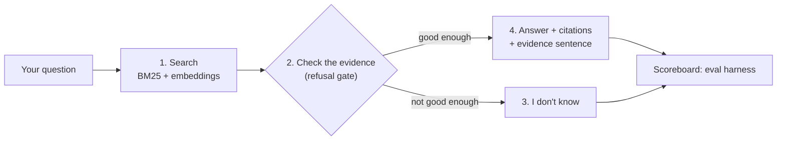

# How RAGLens works (in plain words)

This guide explains every part of RAGLens simply, then lists the questions an interviewer is
likely to ask with short answers you can give in your own words.

## The whole idea in one picture

Imagine a very careful librarian. You ask a question. The librarian:

1. finds the few pages most likely to contain the answer,
2. checks whether those pages *really* talk about your question,
3. if not, says "I don't know" instead of guessing,
4. if yes, answers using only those pages and puts a sticky note on each sentence they used.

RAGLens is that librarian, plus a scoreboard that measures how good the librarian is.

## Step 0: preparing the documents (ingest and chunking)

Documents are long, but a search works best on small pieces. RAGLens cuts each document into
**chunks** of about 512 characters, roughly a paragraph. Neighbouring chunks overlap a little so a
sentence on a boundary is not cut in half. Each chunk remembers which file, page and position it
came from, which is what makes citations possible later.

## Step 1: searching, two ways at once

**BM25 (keyword search).** It counts matching words, but cleverly: rare words like "IBAN" count
much more than common words like "bank", and a word repeated 20 times does not count 20 times
as much. It is excellent for exact terms, codes and names.

**Dense search (embeddings).** An embedding model turns each text into a list of numbers, a
point in "meaning space". Texts that mean similar things land close together even if they use
different words ("loan went bad" is close to "credit-impaired exposure"). It is excellent for
paraphrases.

**Hybrid with Reciprocal Rank Fusion (RRF).** We run both and merge the two ranked lists. RRF
gives each passage `1 / (60 + its rank)` from each list and adds them up. A passage that is near
the top of *both* lists wins. We use ranks, not raw scores, because BM25 scores and similarity
scores are on completely different scales and cannot be added fairly.

**Multi-query (optional).** The question is also searched in two rewritten forms: keywords only,
and with acronyms expanded ("RRF" ↔ "reciprocal rank fusion"). The acronym list is found
automatically by reading the documents. The results are merged with RRF again.

## Step 2: checking the evidence (the refusal gate)

Search *always* returns something, even for "Who won the World Cup?". So before answering, the
gate asks: do these passages really cover the question? It looks at four simple signals:

| Signal | Plain meaning |
|---|---|
| coverage of the top passages | How many of the question's important words appear? |
| best single sentence | Is there one sentence that matches most of the question? |
| missing specific terms | Does the question name something (a bank, a year, "MiCA") the passages never mention? |
| semantic similarity | Do the question and the passages "mean" similar things? |

A small **logistic regression** (from scikit-learn) combines the four signals into a probability
that the question is answerable. The cut-off is chosen by **cost**: a confident wrong answer in
banking is worse than saying "I don't know", so a wrong answer costs 3 and a wrong refusal
costs 1, and we pick the threshold with the lowest total cost. That is the same idea as choosing
a fraud-detection threshold by the cost of missed fraud versus false alarms.

The model is saved as plain JSON numbers, not a pickle file, so loading it cannot run hidden code.

## Step 3: answering with citations and evidence

The best passages are numbered `[1]`, `[2]`, … and sent to the language model with strict
instructions: use only these passages, cite every claim, and say the exact refusal sentence if
the answer is not there. Afterwards RAGLens:

- **cleans up citation styles** real models use (`[1, 2]`, `[1-3]`, `[Source 2]`),
- **recognises refusals** even when the model words them differently,
- **finds the evidence sentence** inside each cited passage that supports the claim, with a
  support score, and highlights it in the UI,
- **adds warnings**, for example when an answer has no citations.

The default language model is a **FakeLLM** that simply copies the best-matching sentences. It
exists so that tests and benchmarks run offline and give the same numbers every time. A real
model (Ollama or any OpenAI-compatible API) is a one-line setting.

## Step 4: the scoreboard (evaluation)

| Metric | Question it answers |
|---|---|
| Hit@k | Was a correct document in the top k results? |
| MRR | How high was the first correct document? (1st place = 1, 2nd = 0.5, …) |
| nDCG@k | Like MRR, but rewards finding *all* relevant documents near the top |
| Citation precision | Of the passages cited, how many came from the right document? |
| Citation support | Does each cited sentence actually contain the claim? |
| Answer F1 / recall | How much does the answer overlap with a reference answer? |
| Refusal accuracy | Did it say "I don't know" to questions it cannot answer? |
| False refusals | Did it wrongly refuse questions it could answer? |

The banking questions are split into a **dev set** (used for tuning) and a **test set** (only
used at the end). Tuning and testing on the same questions would make the scores look better than
they really are.

## Operations

- **`/metrics`** exposes counters and timings for Prometheus (a monitoring system).
- Every request gets an **`X-Request-ID`** that appears in the logs, so one request can be traced.
- Questions are stored in a **SQLite** table, after **masking personal data** (e-mails, IBANs,
  card numbers, phone numbers). `/analytics` summarises them with SQL `GROUP BY` queries.
- An optional **API key** protects uploading, evaluation and analytics.

## Interview questions and answers

**Q: What is RAG and why use it instead of just asking an LLM?**
A: Retrieval-Augmented Generation first searches your own documents and then makes the model
answer only from what it found. You get answers about private or recent information, every claim
can be traced to a source, and hallucinations drop because the model is told to refuse when the
evidence is missing.

**Q: Why hybrid search and not only embeddings?**
A: Embeddings understand paraphrases but are weak on exact codes and names; BM25 is the
opposite. On the ML corpus hybrid had the best ranking and citation precision. On the banking
corpus BM25 was strongest, because my offline hash embedder is weak on paraphrases; that is
exactly what real embeddings should fix, and the benchmark lets me check it. RRF merges the two
lists without having to calibrate their different score scales.

**Q: How does RRF work?**
A: Each document gets `1 / (k + rank)` from every ranked list, with k = 60, and the sums are
compared. It only uses positions, so it needs no tuning and rewards documents both retrievers
agree on.

**Q: How do you stop the system from making things up?**
A: Three layers: a refusal gate before the model is called, a prompt that requires citations and
an exact refusal sentence, and post-checks that find the supporting sentence for each citation
and flag weak or missing citations.

**Q: Tell me about the refusal gate.**
A: It started as a hand-tuned rule: refuse if the passages contain less than half of the
question's words. My harder banking benchmark showed it refused 67% of paraphrased questions and
let half of the unanswerable ones through. I replaced it with a logistic regression on four
features and chose the threshold by cost on a dev set. On held-out questions, correct refusals
went from 50% to 87.5% and wrong refusals from 16.7% to 8.3%.

**Q: Why logistic regression and not something bigger?**
A: I had about 100 labelled questions. A small, interpretable model with four features is the
right size for that data: I can show its weights, and it does not overfit the way a large model
would.

**Q: How did you evaluate it, and what are the weaknesses of your evaluation?**
A: I wrote the questions myself, including paraphrases and unanswerable ones, split dev and test,
and measured retrieval, answers, refusals and latency. Weaknesses: the questions are mine, the set
is small, and the committed numbers use an offline embedder and a fake LLM. I re-ran the key
benchmark with real embeddings and a local Llama model to check the conclusions.
*(Only say the last sentence once you have actually done that run.)*

**Q: What would you change for production?**
A: An approximate vector index like HNSW for millions of chunks, incremental indexing instead of
rebuilding, authentication and rate limiting on every endpoint, a real database for the query log,
and evaluation with an LLM judge plus feedback from real users.

**Q: Why mask personal data in logs?**
A: Under GDPR you should only keep data you need. The analytics need the question topics, not
customers' IBANs or e-mail addresses, so they are masked before anything is written.

**Q: What was the hardest bug?**
A: Two parts used different tokenizers, so "k_1" in the documents never matched "k1" in the
question. I made every component share one tokenizer. Another: the chunker silently dropped the
last characters of each document; a test that checks the chunks cover the whole text caught it.

## Words to search if you want videos

"BM25 explained", "Reciprocal Rank Fusion", "sentence embeddings explained", "what is RAG",
"logistic regression intuition", "precision recall threshold cost", "Prometheus metrics basics".
