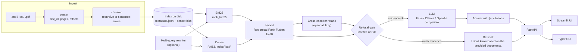

# RAGLens architecture

## Request path (`POST /ask`)

1. **Retrieve.** The chosen retriever returns the top-k chunks. Hybrid asks BM25 and FAISS for
   `max(2k, 20)` candidates each and fuses them with RRF (`score = Σ 1 / (60 + rank)`), breaking
   ties by chunk id so results are deterministic.
2. **Rerank (optional).** With reranking on, a pool of `RERANK_CANDIDATES` is rescored by the
   cross-encoder. If `sentence-transformers` or the model is unavailable, the reranker passes the
   first-stage ranking through unchanged and logs a warning.
3. **Gate.** The pipeline refuses *without calling the LLM* when the best first-stage score is
   below `MIN_RELEVANCE_THRESHOLD` or the refusal gate rejects the evidence (see below). Scores
   alone cannot decide this, because BM25, cosine and RRF scores live on different scales.
4. **Generate.** Passages are numbered `[1]..[k]` in the prompt; the system prompt requires a
   citation for every claim and the exact refusal string when the context is insufficient.
   `[n]` markers in the answer are resolved back to chunks; out-of-range markers are dropped.

## Refusal gate

`compute_features` turns (question, top passages) into four numbers: content-word coverage of the
top three passages, coverage by the single best sentence, the share of *specific* question terms
(capitalised names, numbers, acronyms) absent from the passages and their titles, and the cosine
similarity between question and passages under the active embedder.

- `RuleGate` thresholds coverage alone (`MIN_QUERY_COVERAGE`, 0.5).
- `LearnedGate` applies a logistic regression trained by `raglens.eval.train_gate` on the dev
  questions of both corpora. The decision threshold minimises expected cost on cross-validated
  probabilities, with a confident wrong answer costing three times a wrong refusal. Weights,
  scaling and threshold are stored as JSON together with the embedder name; because similarity
  depends on the embedder, `REFUSAL_GATE=auto` falls back to `RuleGate` when they differ.

Every answer reports `gate` and `gate_score`, so refusals are explainable.

## Multi-query retrieval

`QueryRewriter.from_chunks` mines acronym definitions from the index, matching word initials
(hyphenated words may count once or per part), and keeps the most frequent long form per acronym.
On the sample corpus it finds 18, from `ann` to `sgd`. A question becomes up to three variants
(original, keyword-only, acronym-expanded), each retrieved with the base retriever and fused with
RRF. The glossary is rebuilt automatically whenever the index changes.

## Evidence spans

After generation, the answer is split into sentences and each `[n]` collects the claims that cite
it. Within the cited chunk, `sentence_spans` gives sentence offsets in the original text; the
sentence covering the largest share of a claim's stemmed content words becomes the evidence.
Its offsets let the UI highlight it in place, and `support >= 0.5` marks the citation as supported.

## Observability

An HTTP middleware assigns a request id (or reuses `X-Request-ID`), times the request, updates
Prometheus collectors labelled by route *template* (to keep label cardinality bounded) and writes
an access log line, as JSON when `LOG_JSON=true`. `/ask` also records answer outcomes, per-stage
latency and a `QueryRecord` in a SQLite query log (WAL mode). Personal data (e-mail, IBAN, card,
phone) is masked before the row is written. `/analytics` aggregates the most recent N rows with
parameterised SQL (outcomes, retrievers, top documents, latency percentiles). `/ingest`, `/eval`
and `/analytics` require `X-API-Key` when `API_KEY` is set.

## Components and fallbacks

| Component | Default | Offline fallback |
|---|---|---|
| Embeddings | `all-MiniLM-L6-v2` (extra `[models]`) | `HashEmbedder`: stemmed content-word bag of random vectors |
| Reranker | `cross-encoder/ms-marco-MiniLM-L-6-v2` | pass-through |
| LLM | `FakeLLM` (extractive, deterministic) | — (Ollama / OpenAI-compatible are opt-in) |

LLM providers share one interface with timeouts and exponential-backoff retries (0.5 s, 1 s,
2 s, …) on transport errors, 429 and 5xx; other 4xx responses fail immediately with the status
and body in the error message, which the API returns as `502`.

## Persistence

`IndexStore` writes `metadata.json` (chunks, BM25 parameters, RRF k, embedder name and dimension)
and `dense.faiss`. Loading reuses the FAISS index when the embedder matches and re-embeds the
stored chunks otherwise, so switching embedders never serves vectors from the wrong model.

## Evaluation

`raglens.eval` scores retrieval at document level (`doc_slug` = source file stem) with Hit@k,
Recall@k, MRR and binary nDCG@k for k ∈ {1, 3, 5, 10}; answers with citation precision,
groundedness (content-token overlap with the cited passages) and refusal accuracy on unanswerable
questions; and per-stage latency p50/p95. `python -m raglens.eval.benchmark` runs the
retriever × chunk-size ablation and writes `docs/proof/eval_report.md`, `eval_results.json` and
PNG charts. `--corpus data/corpora/banking --dataset data/eval/banking_test.jsonl` runs the
held-out banking benchmark, adding answer F1, reference recall, citation support and a
per-question-type table.
