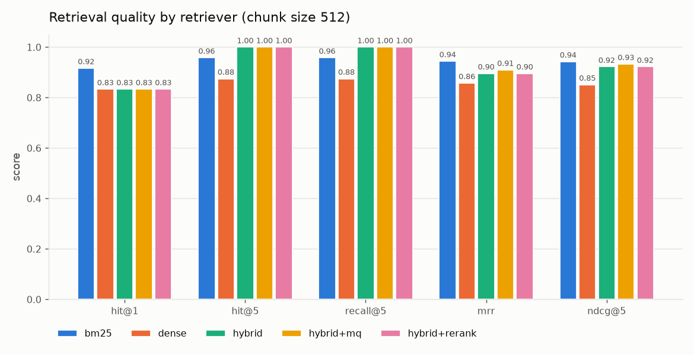
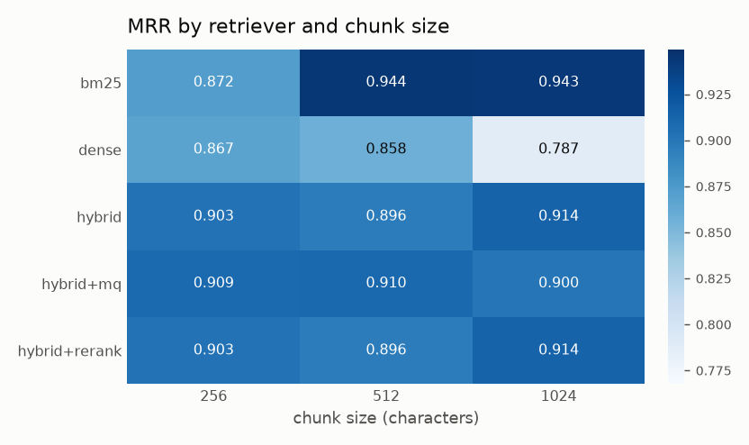
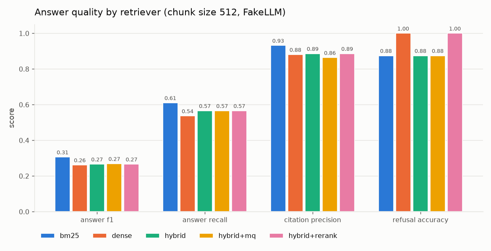

# RAGLens evaluation report

Generated by `python -m raglens.eval.benchmark` on 2026-11-03 14:03 UTC in 2.1s. Every number below comes from that run.

## Setup

- Corpus: `data/corpora/banking`, 14 documents; chunks per size: {256: 192, 512: 98, 1024: 48}
- Questions: 32 (24 answerable, 8 unanswerable)
- Embedder: `hash-384 (fallback)`
- Reranker: `unavailable (pass-through)`
- Generator: FakeLLM (deterministic, extractive)
- Refusal gate: `LearnedGate` (plus best score < 0.01)
- Python 3.11.18 on Linux-6.18.44-fc-v230-x86_64-with-glibc2.39

> **Limitation:** the SentenceTransformers model was not available in this run, so
> dense retrieval used the deterministic `HashEmbedder` (a bag-of-words random
> projection). Dense numbers therefore measure lexical overlap, not semantics.

> **Limitation:** the cross-encoder could not be loaded, so `hybrid+rerank` ran in
> pass-through mode. Its numbers differ from `hybrid` only because the rerank path
> asks for a larger candidate pool, which changes the RRF fusion slightly.

> **Read with care:** the extractive FakeLLM copies context sentences, so
> groundedness is close to 1.0 by construction; answer quality of a real LLM must be
> measured with `--llm ollama` (or `openai`).

## Retrieval (document level, answerable questions)

| Config | Hit@1 | Hit@3 | Hit@5 | Hit@10 | Recall@5 | MRR | nDCG@5 | nDCG@10 |
|---|---|---|---|---|---|---|---|---|
| bm25@256 | 0.792 | 0.917 | 0.958 | 1.000 | 0.958 | 0.872 | 0.888 | 0.903 |
| dense@256 | 0.833 | 0.917 | 0.917 | 0.958 | 0.917 | 0.867 | 0.875 | 0.889 |
| hybrid@256 | 0.833 | 1.000 | 1.000 | 1.000 | 1.000 | 0.903 | 0.928 | 0.928 |
| hybrid+mq@256 | 0.875 | 0.958 | 0.958 | 1.000 | 0.958 | 0.909 | 0.917 | 0.931 |
| hybrid+rerank@256 | 0.833 | 1.000 | 1.000 | 1.000 | 1.000 | 0.903 | 0.928 | 0.928 |
| bm25@512 | 0.917 | 0.958 | 0.958 | 1.000 | 0.958 | 0.944 | 0.943 | 0.958 |
| dense@512 | 0.833 | 0.833 | 0.875 | 0.958 | 0.875 | 0.858 | 0.851 | 0.881 |
| hybrid@512 | 0.833 | 1.000 | 1.000 | 1.000 | 1.000 | 0.896 | 0.922 | 0.922 |
| hybrid+mq@512 | 0.833 | 1.000 | 1.000 | 1.000 | 1.000 | 0.910 | 0.933 | 0.933 |
| hybrid+rerank@512 | 0.833 | 1.000 | 1.000 | 1.000 | 1.000 | 0.896 | 0.922 | 0.922 |
| bm25@1024 | 0.917 | 0.958 | 0.958 | 1.000 | 0.958 | 0.943 | 0.943 | 0.957 |
| dense@1024 | 0.667 | 0.875 | 0.958 | 0.958 | 0.958 | 0.787 | 0.830 | 0.830 |
| hybrid@1024 | 0.875 | 0.958 | 0.958 | 1.000 | 0.958 | 0.914 | 0.922 | 0.934 |
| hybrid+mq@1024 | 0.833 | 0.958 | 0.958 | 1.000 | 0.958 | 0.900 | 0.912 | 0.925 |
| hybrid+rerank@1024 | 0.875 | 0.958 | 0.958 | 1.000 | 0.958 | 0.914 | 0.922 | 0.934 |

## Answers

Answer F1 / recall compare answers with the hand-written reference answers (stemmed
content words; a wrong refusal scores 0). Citation support is the share of citations
whose evidence sentence covers at least half of the cited claim.

| Config | Answer F1 | Answer recall | Citation precision | Citation support | Groundedness | Refusal accuracy | False refusals |
|---|---|---|---|---|---|---|---|
| bm25@256 | 0.299 | 0.560 | 0.864 | 0.976 | 1.000 | 0.875 | 0.083 |
| dense@256 | 0.233 | 0.495 | 0.825 | 0.973 | 1.000 | 1.000 | 0.167 |
| hybrid@256 | 0.255 | 0.551 | 0.810 | 1.000 | 1.000 | 0.875 | 0.125 |
| hybrid+mq@256 | 0.260 | 0.541 | 0.857 | 0.975 | 1.000 | 1.000 | 0.125 |
| hybrid+rerank@256 | 0.255 | 0.551 | 0.810 | 1.000 | 1.000 | 0.875 | 0.125 |
| bm25@512 | 0.306 | 0.611 | 0.932 | 1.000 | 1.000 | 0.875 | 0.083 |
| dense@512 | 0.262 | 0.537 | 0.881 | 0.968 | 1.000 | 1.000 | 0.125 |
| hybrid@512 | 0.266 | 0.566 | 0.886 | 1.000 | 1.000 | 0.875 | 0.083 |
| hybrid+mq@512 | 0.269 | 0.566 | 0.864 | 1.000 | 1.000 | 0.875 | 0.083 |
| hybrid+rerank@512 | 0.266 | 0.566 | 0.886 | 1.000 | 1.000 | 1.000 | 0.083 |
| bm25@1024 | 0.288 | 0.590 | 1.000 | 0.967 | 1.000 | 0.750 | 0.125 |
| dense@1024 | 0.273 | 0.542 | 0.947 | 1.000 | 1.000 | 1.000 | 0.208 |
| hybrid@1024 | 0.287 | 0.590 | 1.000 | 0.960 | 1.000 | 1.000 | 0.125 |
| hybrid+mq@1024 | 0.286 | 0.590 | 0.976 | 0.964 | 1.000 | 1.000 | 0.125 |
| hybrid+rerank@1024 | 0.287 | 0.590 | 1.000 | 0.960 | 1.000 | 1.000 | 0.125 |

## Latency (ms per question)

| Config | retrieve p50 | retrieve p95 | rerank p50 | rerank p95 | generate p50 | generate p95 |
|---|---|---|---|---|---|---|
| bm25@256 | 0.43 | 1.16 | 0.00 | 0.00 | 0.24 | 0.52 |
| dense@256 | 0.08 | 0.16 | 0.00 | 0.00 | 0.17 | 0.27 |
| hybrid@256 | 0.64 | 0.92 | 0.00 | 0.00 | 0.18 | 0.24 |
| hybrid+mq@256 | 2.24 | 3.26 | 0.00 | 0.00 | 0.20 | 0.27 |
| hybrid+rerank@256 | 1.15 | 1.72 | 0.01 | 0.01 | 0.27 | 0.44 |
| bm25@512 | 0.26 | 0.43 | 0.00 | 0.00 | 0.31 | 0.42 |
| dense@512 | 0.08 | 0.12 | 0.00 | 0.00 | 0.28 | 0.40 |
| hybrid@512 | 0.51 | 0.75 | 0.00 | 0.00 | 0.33 | 0.48 |
| hybrid+mq@512 | 1.61 | 2.33 | 0.00 | 0.00 | 0.33 | 0.47 |
| hybrid+rerank@512 | 0.63 | 0.86 | 0.00 | 0.00 | 0.29 | 0.46 |
| bm25@1024 | 0.16 | 0.29 | 0.00 | 0.00 | 0.63 | 0.81 |
| dense@1024 | 0.07 | 0.13 | 0.00 | 0.00 | 0.53 | 0.75 |
| hybrid@1024 | 0.43 | 0.64 | 0.00 | 0.00 | 0.61 | 0.73 |
| hybrid+mq@1024 | 1.32 | 2.09 | 0.00 | 0.00 | 0.57 | 0.80 |
| hybrid+rerank@1024 | 0.57 | 1.16 | 0.00 | 0.01 | 0.62 | 0.92 |

## By question type

MRR for answerable types; share refused for every type (lower is better for
answerable questions, higher is better for unanswerable ones).

| Config | direct MRR | direct refused | multi MRR | multi refused | paraphrase MRR | paraphrase refused | unanswerable MRR | unanswerable refused |
|---|---|---|---|---|---|---|---|---|
| bm25@256 | 0.969 | 0.000 | 1.000 | 0.000 | 0.569 | 0.333 | - | 0.875 |
| dense@256 | 1.000 | 0.062 | 1.000 | 0.000 | 0.468 | 0.500 | - | 1.000 |
| hybrid@256 | 0.969 | 0.000 | 1.000 | 0.000 | 0.694 | 0.500 | - | 0.875 |
| hybrid+mq@256 | 1.000 | 0.000 | 1.000 | 0.000 | 0.635 | 0.500 | - | 1.000 |
| hybrid+rerank@256 | 0.969 | 0.000 | 1.000 | 0.000 | 0.694 | 0.500 | - | 0.875 |
| bm25@512 | 1.000 | 0.000 | 1.000 | 0.000 | 0.778 | 0.333 | - | 0.875 |
| dense@512 | 1.000 | 0.000 | 1.000 | 0.000 | 0.431 | 0.500 | - | 1.000 |
| hybrid@512 | 1.000 | 0.000 | 1.000 | 0.000 | 0.583 | 0.333 | - | 0.875 |
| hybrid+mq@512 | 1.000 | 0.000 | 1.000 | 0.000 | 0.639 | 0.333 | - | 0.875 |
| hybrid+rerank@512 | 1.000 | 0.000 | 1.000 | 0.000 | 0.583 | 0.333 | - | 1.000 |
| bm25@1024 | 1.000 | 0.000 | 1.000 | 0.000 | 0.774 | 0.500 | - | 0.750 |
| dense@1024 | 0.875 | 0.062 | 1.000 | 0.000 | 0.483 | 0.667 | - | 1.000 |
| hybrid@1024 | 1.000 | 0.000 | 1.000 | 0.000 | 0.656 | 0.500 | - | 1.000 |
| hybrid+mq@1024 | 1.000 | 0.000 | 1.000 | 0.000 | 0.602 | 0.500 | - | 1.000 |
| hybrid+rerank@1024 | 1.000 | 0.000 | 1.000 | 0.000 | 0.656 | 0.500 | - | 1.000 |

## Observations

- Best MRR: **bm25@512** (0.944).
- bm25@256 refusal errors: `bt17` (refused answerable), `bt19` (refused answerable), `btu02` (answered unanswerable).
- dense@256 refusal errors: `bt08` (refused answerable), `bt17` (refused answerable), `bt18` (refused answerable), `bt19` (refused answerable).
- hybrid@256 refusal errors: `bt17` (refused answerable), `bt18` (refused answerable), `bt19` (refused answerable), `btu02` (answered unanswerable).
- hybrid+mq@256 refusal errors: `bt17` (refused answerable), `bt18` (refused answerable), `bt19` (refused answerable).
- hybrid+rerank@256 refusal errors: `bt17` (refused answerable), `bt18` (refused answerable), `bt19` (refused answerable), `btu02` (answered unanswerable).
- bm25@512 refusal errors: `bt17` (refused answerable), `bt19` (refused answerable), `btu02` (answered unanswerable).
- dense@512 refusal errors: `bt17` (refused answerable), `bt18` (refused answerable), `bt19` (refused answerable).
- hybrid@512 refusal errors: `bt17` (refused answerable), `bt19` (refused answerable), `btu02` (answered unanswerable).
- hybrid+mq@512 refusal errors: `bt17` (refused answerable), `bt19` (refused answerable), `btu08` (answered unanswerable).
- hybrid+rerank@512 refusal errors: `bt17` (refused answerable), `bt19` (refused answerable).
- bm25@1024 refusal errors: `bt17` (refused answerable), `bt19` (refused answerable), `bt20` (refused answerable), `btu02` (answered unanswerable), `btu08` (answered unanswerable).
- dense@1024 refusal errors: `bt06` (refused answerable), `bt17` (refused answerable), `bt18` (refused answerable), `bt19` (refused answerable), `bt20` (refused answerable).
- hybrid@1024 refusal errors: `bt17` (refused answerable), `bt19` (refused answerable), `bt20` (refused answerable).
- hybrid+mq@1024 refusal errors: `bt17` (refused answerable), `bt19` (refused answerable), `bt20` (refused answerable).
- hybrid+rerank@1024 refusal errors: `bt17` (refused answerable), `bt19` (refused answerable), `bt20` (refused answerable).

## Charts

