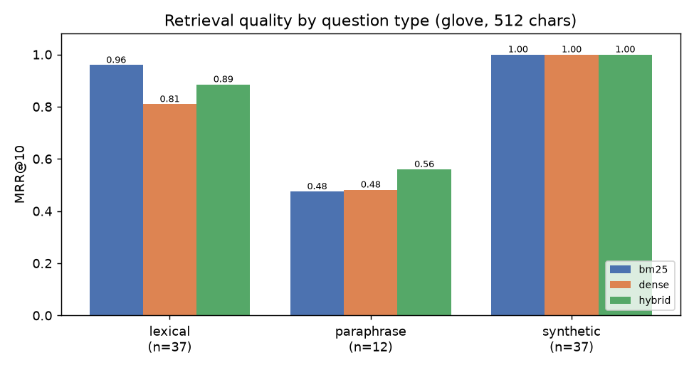
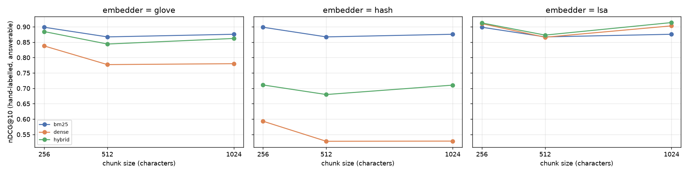
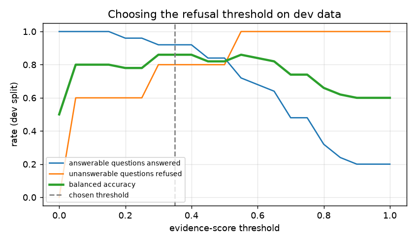
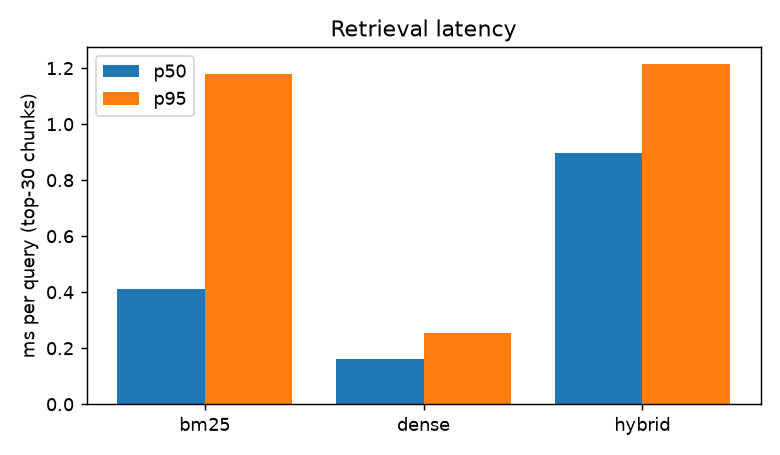

# RAGLens evaluation report

Generated by `raglens eval`. Every number below comes from that command; the raw data is
in `eval_results.json` next to this file.

## Setup

- Questions: {'lexical': 37, 'paraphrase': 12, 'unanswerable': 10} (hand-written, `data/eval/qa.jsonl`) plus 37 synthetic questions generated from chunks.
- Main configuration: embedder `glove`, chunk size 512 (196 chunks), generator `fake`, top-k 5.
- Cross-encoder reranker `cross-encoder/ms-marco-MiniLM-L-6-v2`: ModuleNotFoundError: No module named 'sentence_transformers'.
- Retrieval is scored at document level: chunks are collapsed to their source file, so two chunks of the same file count once.

## 1. Retrieval quality (answerable hand-labelled questions)

| Retriever | Hit@1 | Hit@3 | Hit@5 | Recall@5 | MRR@10 | nDCG@10 | p50 ms | p95 ms |
|---|---|---|---|---|---|---|---|---|
| bm25 | 0.755 | 0.918 | 0.939 | 0.929 | 0.841 | 0.867 | 0.41 | 1.18 |
| dense | 0.612 | 0.796 | 0.918 | 0.918 | 0.729 | 0.777 | 0.16 | 0.25 |
| hybrid | 0.714 | 0.918 | 0.918 | 0.918 | 0.806 | 0.844 | 0.90 | 1.21 |

### By question type (MRR@10 / Hit@5)

| Retriever | lexical | paraphrase | synthetic |
|---|---|---|---|
| bm25 | 0.959 / 1.000 | 0.475 / 0.750 | 1.000 / 1.000 |
| dense | 0.810 / 0.973 | 0.482 / 0.750 | 1.000 / 1.000 |
| hybrid | 0.886 / 0.973 | 0.560 / 0.750 | 1.000 / 1.000 |

### Is hybrid really better? Paired bootstrap on MRR (2,000 resamples)

| Comparison | Mean difference | 95% CI | Verdict |
|---|---|---|---|
| hybrid vs bm25 mrr | -0.035 | [-0.112, +0.038] | not significant (CI contains 0) |
| hybrid vs dense mrr | +0.076 | [+0.009, +0.145] | significant |

## 2. Answers and refusals (test split only)

The refusal threshold was chosen on the dev split: **0.35** (share of the question's content words that the best passage must contain).

| Metric | Value |
|---|---|
| Unanswerable questions correctly refused | 1.000 |
| Answerable questions wrongly refused | 0.167 |
| Overall answer/refuse decision accuracy | 0.862 |
| Citation precision (cited passage from a relevant doc) | 0.725 |
| Groundedness (answer words found in cited passages) | 1.000 |
| Token F1 against reference answer | 0.198 |
| Latency p50 / p95, retrieve | 0.70 / 0.94 ms |
| Latency p50 / p95, generate | 0.14 / 0.20 ms |
| Latency p50 / p95, end to end | 1.02 / 1.41 ms |

## 3. Ablation: retriever x chunk size x embedder

| Embedder | Chunk size | Chunks | Retriever | Hit@1 | Hit@5 | MRR@10 | nDCG@10 |
|---|---|---|---|---|---|---|---|
| glove | 256 | 367 | bm25 | 0.857 | 0.918 | 0.884 | 0.898 |
| glove | 256 | 367 | dense | 0.694 | 0.939 | 0.797 | 0.838 |
| glove | 256 | 367 | hybrid | 0.776 | 0.918 | 0.851 | 0.884 |
| glove | 512 | 196 | bm25 | 0.755 | 0.939 | 0.841 | 0.867 |
| glove | 512 | 196 | dense | 0.612 | 0.918 | 0.729 | 0.777 |
| glove | 512 | 196 | hybrid | 0.714 | 0.918 | 0.806 | 0.844 |
| glove | 1024 | 77 | bm25 | 0.796 | 0.918 | 0.851 | 0.876 |
| glove | 1024 | 77 | dense | 0.612 | 0.878 | 0.724 | 0.780 |
| glove | 1024 | 77 | hybrid | 0.755 | 0.918 | 0.826 | 0.862 |
| lsa | 256 | 367 | bm25 | 0.857 | 0.918 | 0.884 | 0.898 |
| lsa | 256 | 367 | dense | 0.857 | 0.939 | 0.891 | 0.910 |
| lsa | 256 | 367 | hybrid | 0.857 | 0.939 | 0.892 | 0.912 |
| lsa | 512 | 196 | bm25 | 0.755 | 0.939 | 0.841 | 0.867 |
| lsa | 512 | 196 | dense | 0.776 | 0.898 | 0.837 | 0.866 |
| lsa | 512 | 196 | hybrid | 0.776 | 0.918 | 0.844 | 0.873 |
| lsa | 1024 | 77 | bm25 | 0.796 | 0.918 | 0.851 | 0.876 |
| lsa | 1024 | 77 | dense | 0.837 | 0.939 | 0.886 | 0.903 |
| lsa | 1024 | 77 | hybrid | 0.857 | 0.939 | 0.892 | 0.914 |
| hash | 256 | 367 | bm25 | 0.857 | 0.918 | 0.884 | 0.898 |
| hash | 256 | 367 | dense | 0.429 | 0.694 | 0.543 | 0.593 |
| hash | 256 | 367 | hybrid | 0.592 | 0.837 | 0.668 | 0.711 |
| hash | 512 | 196 | bm25 | 0.755 | 0.939 | 0.841 | 0.867 |
| hash | 512 | 196 | dense | 0.367 | 0.633 | 0.471 | 0.528 |
| hash | 512 | 196 | hybrid | 0.510 | 0.776 | 0.622 | 0.680 |
| hash | 1024 | 77 | bm25 | 0.796 | 0.918 | 0.851 | 0.876 |
| hash | 1024 | 77 | dense | 0.347 | 0.612 | 0.466 | 0.529 |
| hash | 1024 | 77 | hybrid | 0.571 | 0.776 | 0.656 | 0.710 |

## 4. Where the retrievers disagree

| Id | Type | Question | Relevant | BM25 | Dense | Hybrid |
|---|---|---|---|---|---|---|
| q03 | lexical | What does AdamW change compared to Adam? | 01_gradient_descent | 1.000 | 0.200 | 1.000 |
| q05 | lexical | How does dropout behave during inference? | 02_overfitting_and_regularization | 1.000 | 0.500 | 1.000 |
| q12 | lexical | Which models are encoder-only, decoder-only and encoder-decoder transformers? | 05_transformers_architecture | 1.000 | 0.500 | 1.000 |
| q16 | lexical | How does WordPiece choose which pair to merge? | 07_tokenization_algorithms | 1.000 | 0.500 | 1.000 |
| q20 | lexical | How is Mean Reciprocal Rank computed? | 10_retrieval_evaluation_metrics | 1.000 | 0.500 | 1.000 |
| q22 | lexical | What do the k1 and b parameters control in BM25? | 11_lexical_search_bm25 | 1.000 | 1.000 | 0.500 |
| q26 | lexical | What is the difference between a bi-encoder and a cross-encoder? | 08_vector_embeddings, 13_cross_encoder_reranking | 1.000 | 0.111 | 0.100 |
| q30 | lexical | What is a contextual anomaly? | 15_anomaly_detection | 0.500 | 0.200 | 0.500 |
| q32 | lexical | How does HNSW search work? | 17_vector_databases_and_ann | 1.000 | 0.250 | 0.333 |
| q37 | lexical | What does the KV-cache store during generation? | 20_quantization_and_inference | 1.000 | 0.200 | 0.333 |
| q38 | paraphrase | How do I stop a model from memorising its training examples instead of learning general patterns? | 02_overfitting_and_regularization | 0.500 | 1.000 | 1.000 |
| q39 | paraphrase | Why might my training run blow up if each update step is too big? | 01_gradient_descent | 1.000 | 0.000 | 0.333 |
| q40 | paraphrase | How can text be split into pieces when a word was never seen before? | 07_tokenization_algorithms | 0.200 | 0.200 | 0.333 |
| q41 | paraphrase | Why can a search for doctor miss a page that only says physician? | 08_vector_embeddings | 0.333 | 0.000 | 0.000 |
| q42 | paraphrase | How can the system avoid answering when the documents do not contain the answer? | 09_retrieval_augmented_generation, 19_hallucination_and_groundedness | 1.000 | 0.500 | 1.000 |
| q43 | paraphrase | How can a huge collection of vectors be searched quickly if a few misses are acceptable? | 17_vector_databases_and_ann | 0.167 | 0.250 | 0.500 |
| q44 | paraphrase | How can I shrink a big language model so it fits on a smaller GPU? | 20_quantization_and_inference | 0.000 | 0.333 | 0.111 |
| q45 | paraphrase | What should I watch for after a model is live and the incoming data slowly changes? | 16_mlops_production_systems | 0.500 | 0.500 | 1.000 |
| q47 | paraphrase | How does each word decide which other words in the sentence to focus on? | 06_attention_mechanisms | 0.500 | 0.000 | 0.111 |
| q48 | paraphrase | How can a neural network flag unusual inputs by trying to rebuild them? | 15_anomaly_detection | 0.000 | 1.000 | 0.333 |
| q49 | paraphrase | How can a second, slower model reorder the first-stage search results more accurately? | 13_cross_encoder_reranking | 0.500 | 1.000 | 1.000 |

## 5. Hybrid misses (relevant document not in top 5)

| Id | Type | Question | Relevant | Hybrid top 3 |
|---|---|---|---|---|
| q26 | lexical | What is the difference between a bi-encoder and a cross-encoder? | 08_vector_embeddings, 13_cross_encoder_reranking | 03_bias_variance_tradeoff, 11_lexical_search_bm25, 01_gradient_descent |
| q41 | paraphrase | Why can a search for doctor miss a page that only says physician? | 08_vector_embeddings | 10_retrieval_evaluation_metrics, 13_cross_encoder_reranking, 15_anomaly_detection |
| q44 | paraphrase | How can I shrink a big language model so it fits on a smaller GPU? | 20_quantization_and_inference | 13_cross_encoder_reranking, 07_tokenization_algorithms, 17_vector_databases_and_ann |
| q47 | paraphrase | How does each word decide which other words in the sentence to focus on? | 06_attention_mechanisms | 18_chunking_strategies_rag, 11_lexical_search_bm25, 19_hallucination_and_groundedness |

## Charts

