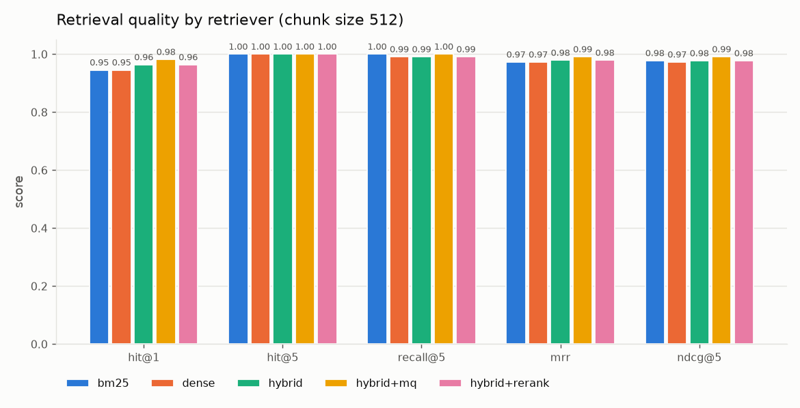
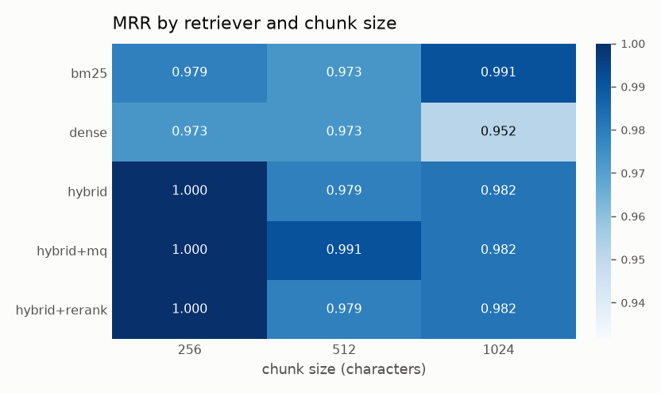
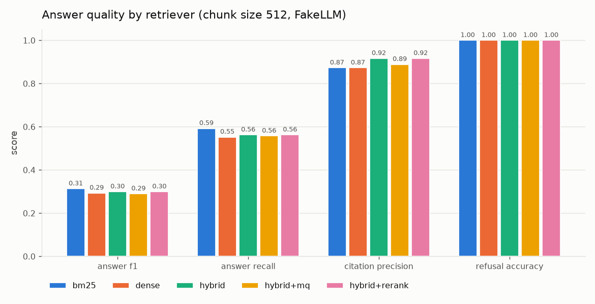

# RAGLens evaluation report

Generated by `python -m raglens.eval.benchmark` on 2026-11-03 14:03 UTC in 4.2s. Every number below comes from that run.

## Setup

- Corpus: `data/sample_corpus`, 20 documents; chunks per size: {256: 253, 512: 133, 1024: 64}
- Questions: 63 (55 answerable, 8 unanswerable)
- Embedder: `hash-384 (fallback)`
- Reranker: `unavailable (pass-through)`
- Generator: FakeLLM (deterministic, extractive)
- Refusal gate: `LearnedGate` (plus best score < 0.01)
- Python 3.11.18 on Linux-6.18.44-fc-v230-x86_64-with-glibc2.39

> **Limitation:** the SentenceTransformers model was not available in this run, so
> dense retrieval used the deterministic `HashEmbedder` (a bag-of-words random
> projection). Dense numbers therefore measure lexical overlap, not semantics.

> **Limitation:** the cross-encoder could not be loaded, so `hybrid+rerank` ran in
> pass-through mode. Its numbers differ from `hybrid` only because the rerank path
> asks for a larger candidate pool, which changes the RRF fusion slightly.

> **Read with care:** the extractive FakeLLM copies context sentences, so
> groundedness is close to 1.0 by construction; answer quality of a real LLM must be
> measured with `--llm ollama` (or `openai`).

## Retrieval (document level, answerable questions)

| Config | Hit@1 | Hit@3 | Hit@5 | Hit@10 | Recall@5 | MRR | nDCG@5 | nDCG@10 |
|---|---|---|---|---|---|---|---|---|
| bm25@256 | 0.964 | 1.000 | 1.000 | 1.000 | 1.000 | 0.979 | 0.982 | 0.982 |
| dense@256 | 0.945 | 1.000 | 1.000 | 1.000 | 0.991 | 0.973 | 0.973 | 0.973 |
| hybrid@256 | 1.000 | 1.000 | 1.000 | 1.000 | 1.000 | 1.000 | 0.997 | 0.997 |
| hybrid+mq@256 | 1.000 | 1.000 | 1.000 | 1.000 | 1.000 | 1.000 | 0.999 | 0.999 |
| hybrid+rerank@256 | 1.000 | 1.000 | 1.000 | 1.000 | 1.000 | 1.000 | 0.998 | 0.998 |
| bm25@512 | 0.945 | 1.000 | 1.000 | 1.000 | 1.000 | 0.973 | 0.978 | 0.978 |
| dense@512 | 0.945 | 1.000 | 1.000 | 1.000 | 0.991 | 0.973 | 0.973 | 0.973 |
| hybrid@512 | 0.964 | 1.000 | 1.000 | 1.000 | 0.991 | 0.979 | 0.977 | 0.977 |
| hybrid+mq@512 | 0.982 | 1.000 | 1.000 | 1.000 | 1.000 | 0.991 | 0.991 | 0.991 |
| hybrid+rerank@512 | 0.964 | 1.000 | 1.000 | 1.000 | 0.991 | 0.979 | 0.977 | 0.981 |
| bm25@1024 | 0.982 | 1.000 | 1.000 | 1.000 | 1.000 | 0.991 | 0.992 | 0.992 |
| dense@1024 | 0.909 | 1.000 | 1.000 | 1.000 | 0.991 | 0.952 | 0.957 | 0.957 |
| hybrid@1024 | 0.964 | 1.000 | 1.000 | 1.000 | 1.000 | 0.982 | 0.984 | 0.984 |
| hybrid+mq@1024 | 0.964 | 1.000 | 1.000 | 1.000 | 1.000 | 0.982 | 0.985 | 0.985 |
| hybrid+rerank@1024 | 0.964 | 1.000 | 1.000 | 1.000 | 1.000 | 0.982 | 0.984 | 0.984 |

## Answers

Answer F1 / recall compare answers with the hand-written reference answers (stemmed
content words; a wrong refusal scores 0). Citation support is the share of citations
whose evidence sentence covers at least half of the cited claim.

| Config | Answer F1 | Answer recall | Citation precision | Citation support | Groundedness | Refusal accuracy | False refusals |
|---|---|---|---|---|---|---|---|
| bm25@256 | 0.312 | 0.536 | 0.887 | 1.000 | 0.992 | 1.000 | 0.036 |
| dense@256 | 0.281 | 0.492 | 0.794 | 1.000 | 0.993 | 1.000 | 0.073 |
| hybrid@256 | 0.295 | 0.508 | 0.806 | 1.000 | 0.994 | 1.000 | 0.018 |
| hybrid+mq@256 | 0.283 | 0.506 | 0.824 | 1.000 | 0.990 | 1.000 | 0.018 |
| hybrid+rerank@256 | 0.295 | 0.508 | 0.806 | 1.000 | 0.994 | 1.000 | 0.018 |
| bm25@512 | 0.313 | 0.593 | 0.873 | 1.000 | 0.995 | 1.000 | 0.000 |
| dense@512 | 0.293 | 0.552 | 0.873 | 1.000 | 0.994 | 1.000 | 0.000 |
| hybrid@512 | 0.299 | 0.562 | 0.917 | 1.000 | 0.992 | 1.000 | 0.018 |
| hybrid+mq@512 | 0.290 | 0.557 | 0.889 | 1.000 | 0.990 | 1.000 | 0.018 |
| hybrid+rerank@512 | 0.299 | 0.562 | 0.917 | 1.000 | 0.992 | 1.000 | 0.018 |
| bm25@1024 | 0.314 | 0.589 | 0.845 | 0.959 | 0.992 | 1.000 | 0.000 |
| dense@1024 | 0.305 | 0.564 | 0.873 | 1.000 | 0.996 | 1.000 | 0.000 |
| hybrid@1024 | 0.305 | 0.584 | 0.827 | 1.000 | 0.997 | 1.000 | 0.000 |
| hybrid+mq@1024 | 0.297 | 0.575 | 0.836 | 0.987 | 0.995 | 1.000 | 0.000 |
| hybrid+rerank@1024 | 0.305 | 0.584 | 0.827 | 1.000 | 0.997 | 1.000 | 0.000 |

## Latency (ms per question)

| Config | retrieve p50 | retrieve p95 | rerank p50 | rerank p95 | generate p50 | generate p95 |
|---|---|---|---|---|---|---|
| bm25@256 | 0.42 | 0.86 | 0.00 | 0.00 | 0.19 | 0.30 |
| dense@256 | 0.14 | 0.22 | 0.00 | 0.00 | 0.24 | 0.39 |
| hybrid@256 | 0.74 | 0.95 | 0.00 | 0.00 | 0.18 | 0.27 |
| hybrid+mq@256 | 1.95 | 3.72 | 0.00 | 0.00 | 0.19 | 0.30 |
| hybrid+rerank@256 | 0.99 | 1.63 | 0.00 | 0.01 | 0.19 | 0.38 |
| bm25@512 | 0.37 | 0.58 | 0.00 | 0.00 | 0.37 | 0.65 |
| dense@512 | 0.07 | 0.12 | 0.00 | 0.00 | 0.27 | 0.37 |
| hybrid@512 | 0.52 | 0.70 | 0.00 | 0.00 | 0.28 | 0.36 |
| hybrid+mq@512 | 1.44 | 2.45 | 0.00 | 0.00 | 0.29 | 0.37 |
| hybrid+rerank@512 | 0.79 | 1.52 | 0.00 | 0.01 | 0.31 | 0.61 |
| bm25@1024 | 0.17 | 0.25 | 0.00 | 0.00 | 0.55 | 0.77 |
| dense@1024 | 0.07 | 0.17 | 0.00 | 0.00 | 0.54 | 0.69 |
| hybrid@1024 | 0.43 | 0.82 | 0.00 | 0.00 | 0.58 | 1.15 |
| hybrid+mq@1024 | 1.32 | 2.17 | 0.00 | 0.00 | 0.58 | 0.78 |
| hybrid+rerank@1024 | 0.57 | 0.88 | 0.00 | 0.01 | 0.58 | 0.74 |

## By question type

MRR for answerable types; share refused for every type (lower is better for
answerable questions, higher is better for unanswerable ones).

| Config | direct MRR | direct refused | unanswerable MRR | unanswerable refused |
|---|---|---|---|---|
| bm25@256 | 0.979 | 0.036 | - | 1.000 |
| dense@256 | 0.973 | 0.073 | - | 1.000 |
| hybrid@256 | 1.000 | 0.018 | - | 1.000 |
| hybrid+mq@256 | 1.000 | 0.018 | - | 1.000 |
| hybrid+rerank@256 | 1.000 | 0.018 | - | 1.000 |
| bm25@512 | 0.973 | 0.000 | - | 1.000 |
| dense@512 | 0.973 | 0.000 | - | 1.000 |
| hybrid@512 | 0.979 | 0.018 | - | 1.000 |
| hybrid+mq@512 | 0.991 | 0.018 | - | 1.000 |
| hybrid+rerank@512 | 0.979 | 0.018 | - | 1.000 |
| bm25@1024 | 0.991 | 0.000 | - | 1.000 |
| dense@1024 | 0.952 | 0.000 | - | 1.000 |
| hybrid@1024 | 0.982 | 0.000 | - | 1.000 |
| hybrid+mq@1024 | 0.982 | 0.000 | - | 1.000 |
| hybrid+rerank@1024 | 0.982 | 0.000 | - | 1.000 |

## Observations

- Best MRR: **hybrid+mq@256** (1.000).
- bm25@256 refusal errors: `q19` (refused answerable), `q50` (refused answerable).
- dense@256 refusal errors: `q15` (refused answerable), `q28` (refused answerable), `q30` (refused answerable), `q34` (refused answerable).
- hybrid@256 refusal errors: `q15` (refused answerable).
- hybrid+mq@256 refusal errors: `q15` (refused answerable).
- hybrid+rerank@256 refusal errors: `q15` (refused answerable).
- hybrid@512 refusal errors: `q32` (refused answerable).
- hybrid+mq@512 refusal errors: `q32` (refused answerable).
- hybrid+rerank@512 refusal errors: `q32` (refused answerable).

## Charts

